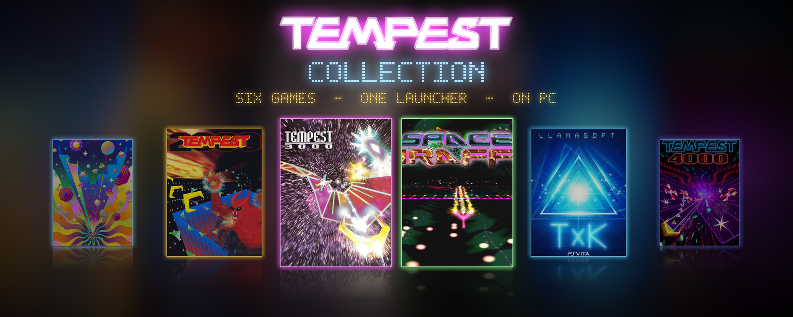

# Tempest Collection

This is the latest in a series of collections made to bring the lost games of Jeff Minter (aka Llamasoft) to modern
PCs, following our earlier releases of the iOS [Minotaur Project](https://github.com/jedeyesniv-art/MinotaurProjectRemastered)
and [Llamasoft's Atari ST games](https://github.com/jedeyesniv-art/Llamasoft-on-the-Atari).

This project follows a line of thought I call **Emulation++**. It is not a decompilation or a recompilation: the games
in this collection run on a heavily modified form of emulation, in which our layer catches and interprets many of the
calls the game makes, such as its visuals and controls. This gives us much greater freedom over the presentation
without changing anything about the original game.

The project began as a simple investigation into the workings of Tempest 2000, to see whether it could be given a
sharper vector look - the Jaguar was never capable of the smooth presentation the game begs for. The vector lines and
the web fill are now redrawn as new, crisp lines that scale to your display and frame rate. The controls were adapted
from d-pad to stick and carefully tuned by hand to give the best experience possible. The game has been adapted to
widescreen, and the look is complemented by our custom CRT++ filter. Every improvement can be turned off if you wish.

Once this was done, fans of the series asked whether I was going to cover the other games in the series too, so I began
to look into it. The PS Vita's TxK was an obvious choice given its rarity, and it was easy to include through the Vita3K
libretro core. Very little work has gone into improving this already excellent game, but you can raise its resolution
if your machine is capable. On the Steam Deck it needs to run at native resolution.

The real discovery of this project was Tempest 3000 on the Nuon. Before starting, I had no idea it existed, so finding
out about it was exciting enough on its own. The Nuance emulator has recently reached the point where the game is fully
playable, although early tests proved it challenging to get running at all, and the game generally needed a very
powerful computer to give good results.

In getting Tempest 3000 playing on PC, this project has also deconstructed its visual output to allow high resolution,
smooth output, and finely tuned controls that work with modern controllers. Every effort has been made to reduce control
latency and to give the game a feel that sits somewhere between the stiffer feel of Tempest 2000 and the smoother
movement of TxK. The game is found online as a disc image; this project also includes a tool that unpacks and
compresses it to save disc space.

At this point Tempest 3000 is highly playable, incredibly beautiful and runs fantastically well. The general feel of
the game is configurable, since the game's speed is set by its internal frame rate. The original most likely ran at
around 30 fps; I prefer it slightly slower at 26, but you can choose. Smooth motion interpolation means play still
feels smooth, and run-ahead is available to reduce latency further if you have the CPU for it. Run-ahead is too much for
the Steam Deck, but testing shows the game plays well there without it.

The original 1981 arcade Tempest is also included, through MAME emulation, with some added work to thicken the vector
graphics and make better use of modern displays.

For completeness, Space Giraffe and Tempest 4000 are there too, through Steam. If you own them on Steam, this collection
will not only launch them but also patch them to play better on modern systems. Both games take on your system's
resolution and refresh rate; for Space Giraffe this makes it fullscreen, and for Tempest 4000 it also fixes a bug where
the music would not play on the Steam Deck.

This project was made using AI as a tool, but it has been extensively curated and tuned by a human. Claude's release
notes follow, with more detail.

---

## Release notes

*Written by Claude (Anthropic's AI model), which wrote most of the code in this project under the owner's direction.*

### What you get

One launcher, `TempestCollection.exe`, with the six games in release order. Pick a game with left / right and press A;
each game opens full screen and comes back to the launcher when you quit. Back (View) on the pad opens each game's
settings menu, which pauses the game.

| Game | System | How it runs |
|---|---|---|
| Tempest (1981) | Arcade | MAME core, with our own vector renderer |
| Tempest 2000 (1994) | Atari Jaguar | Virtual Jaguar core + our native renderer ("Remaster") |
| Tempest 3000 (2000) | Nuon | Nuance core + our native renderer |
| Space Giraffe (2008) | PC | Your Steam copy, started and patched by the launcher |
| TxK (2014) | PS Vita | Vita3K core |
| Tempest 4000 (2018) | PC | Your Steam copy, started and patched by the launcher |

The last panel, **More Llamasoft**, lists Jeff Minter's games on Steam and our other collections.

### You need to bring your own games

The collection contains **no game data, ROMs, disc images or firmware**. Put your own copies in the `game` folder next
to `TempestCollection.exe` (the PS Vita firmware goes in `vita_firmware`). Until a game's files are there, the launcher
greys that game out and tells you exactly which file it is looking for and where it goes.

| Game | What to put where | Notes |
|---|---|---|
| Tempest (1981) | `game\tempest.zip` | The MAME romset (MAME 0.289 or later). Rev 3 is played; a merged set (with `temptube`) also offers Tempest Tubes in the game's menu. |
| Tempest 2000 | `game\<name with "Tempest">.jag` (or `.j64`) | Tested with the 2 MB cartridge image, MD5 `602bc9953d3737b1ba52b2a0d9932f7c`. |
| Tempest 3000 | `game\<name with "Tempest">.iso` or `.mdf` | A DVD `.mdf` is read directly (the `.mds` beside it isn't needed). On first start the launcher offers to compress it (743 MB -> ~196 MB, about a minute), then to delete the original. |
| TxK | `game\PCSB00494\` (the game folder: `eboot.bin`, `sce_sys\` ...) | Tested with PCSB00494 (Europe). |
| PS Vita firmware (for TxK) | `vita_firmware\PSVUPDAT.PUP` and `vita_firmware\PSP2UPDAT.PUP` | Both are free downloads from Sony's PS Vita system software pages. Installed automatically on TxK's first start (the `.PUP` files can be deleted afterwards). |
| Space Giraffe, Tempest 4000 | Install them in Steam | Not installed? The launcher's A button opens their store page. |

The Nuon BIOS is not needed: Tempest 3000 runs on the Nuance emulator's own open-source BIOS replacement, included.

### Requirements

- Windows 10 / 11 (64-bit) with a Direct3D 12 capable GPU; a gamepad (Xbox layout) recommended. Keyboard works too.
- Steam Deck: works through Proton (see below). Run-ahead for Tempest 3000 is too costly there; everything else plays well.
- Tempest 3000 is the demanding one: a recent desktop CPU is comfortable; with run-ahead, more so.

### Installing

1. Unzip the collection anywhere (it keeps its settings and saves in its own `userdata` folder).
2. Add your game files as above.
3. Run `TempestCollection.exe`. Press **Y** in the launcher to add the collection to Steam with its library art (Steam
   closes for a moment and restarts).

**Steam Deck:** copy the folder to the Deck (e.g. `/home/deck/Games/TempestCollection`). In desktop mode, add
`TempestCollection.exe` to Steam as a non-Steam game and force Proton (Properties > Compatibility). In the launcher, Y
puts the library art in place. Space Giraffe and Tempest 4000 need a one-time Steam launch option each; the launcher
shows the exact line to paste when it is missing.

### Per game

**Tempest (1981)**
- MAME 0.289, cut down to just the Tempest driver. The vector beams are drawn by us, not MAME: thick, glowing,
  sub-pixel lines at any resolution, with wide-screen framing.
- Stick or d-pad spins the spinner (with a curve for fine control); mouse spinner supported.
- Versions: rev 3 and Tempest Tubes. Save states.

**Tempest 2000**
- The Remaster renderer: the web, the vectors, the claw, enemies, particles, the starfields and warps are drawn
  natively on the GPU in high resolution, at your display's refresh rate with interpolated motion, and widened to fill
  16:9 and wider screens. The HUD moves to the screen corners. Renderer "Emulation" shows the original picture.
- Stick controls with two modes: left / right (tuned ramp and ease-off) and aim (point the stick at a lane).
- Run-ahead (2 frames by default, during play) to cut input lag; camera view cycle on LB; quit to title from the pause
  screen.
- High scores and options saved (the cartridge's EEPROM), five save-state slots, button remapping.
- Cheats menu, including Beastly mode.

**Tempest 3000**
- Every picture is drawn natively from the game's display lists: high resolution, wide screens, and smooth motion
  interpolated between the game's own frames.
- Game speed (pictures per second, 15-60; default 26) and a separate warp speed, so the game's feel is yours to set.
- Stick modes: Step (default: a push = one lane, hold to sweep), Stiff (Tempest 2000-like) and Left / right.
- Run-ahead (0-4, default 2; lowered automatically when the CPU can't keep up - set it to Off on the Steam Deck).
  No "controller configuration" screen at boot. High scores kept between sessions.
- Save states, infinite lives cheat, "Restart the game".
- The disc compression tool (`.nuz`: the music re-encoded as Ogg Vorbis, the rest untouched).

**Space Giraffe** (Steam)
- A small helper (a proxy `d3d9.dll`) is copied next to the game each time the launcher starts it: borderless full
  screen at your desktop's resolution and refresh rate, English chosen automatically, your flavour (Acid / Nuxx, up /
  down in the launcher) picked for you, and a stick deadzone so the menus no longer jump.

**TxK**
- Vita3K. The game's button prompts are rewritten for an Xbox pad (Cross -> A and so on; Select -> LB).
- The touchscreen (Supertapper) is the mouse / touch screen.
- Internal resolution option (keep 1x on the Steam Deck); sharp pixel scaling and 16x texture filtering by default.

**Tempest 4000** (Steam)
- A small helper (a proxy `xinput1_4.dll`) skips the start-up video mode window and starts at your desktop's
  resolution and refresh rate (including 4K at 120 Hz, which the game's own list can't reach).
- Steam Deck: the music now plays (the launcher points the game at the music files Proton can play).

**Everywhere**
- One settings menu layout in every game: Game, Controls, Picture, CRT, Cheats, Return to launcher. Changes are saved
  immediately.
- CRT looks: off, CRT+ and, where the renderer allows it, CRT++ (trails, bleed, glow); fine-tune sliders.
- Even loudness: every game is measured and levelled to the same loudness, with a master volume in the launcher.
- Button remapping in every game's menu.

### Known issues

- Space Giraffe: the in-game "hi-res objects" option is not remembered between sessions (a bug in the game itself).
- Tempest 3000 on the Steam Deck: possibly a brief hitch at the start of a level while its music track is decoded.
- TxK: touchscreen input on the Steam Deck is untested.
- Tempest 3000's run-ahead is turned down automatically if your CPU can't keep up.

### Building from source

Everything needed is in this repository: our programs (`src`), the two heavily changed emulator cores
(`third_party/virtualjaguar`, `third_party/NuanceResurrection`, each with a `LLAMASOFT-NOTES.txt`), and our changes to
MAME and Vita3K as patches (`third_party/patches`). Windows, Visual Studio 2026 (18) with its clang, CMake and Ninja,
Git Bash, Python 3 with Pillow for the art tools.

1. `bash tools/get_third_party.sh` - fetches SDL 3.4.16, MAME (libretro) and Vita3K (libretro) at the commits we
   use and applies our patches. Unzip Strawberry Perl Portable 5.42.3.1 (64-bit) to `third_party/strawberry`.
2. `build.bat` - the launcher and the four programs into `build\` (Virtual Jaguar is built into `t2k.exe`).
3. `tools\build_nuance.bat` (Tempest 3000's core), `bash tools/build_mame.sh` (the arcade core, the Tempest driver only),
   `tools\build_vita3k.bat` (TxK's core), `tools\build_t4k_helper.bat` and `tools\build_sg_helper.bat` (the Steam helpers).
4. The launcher's art and sounds are in `art/` already. To remake them: `tools/launcher_art.py` and
   `tools/more_art.py` (from source pictures in `art/`, not in git), `tools/steam_art.py`, `tools/github_art.py`,
   `tools/launcher_sounds.py` (from the games' files).
5. `powershell -ExecutionPolicy Bypass -File tools\package_collection.ps1 -Release -SkipBuild` - the release folder
   and zip in `dist\`.

### Credits and licences

- Tempest (1981): Dave Theurer, Atari. Tempest 2000, Tempest 3000, Space Giraffe, TxK, Tempest 4000: Jeff Minter,
  Llamasoft. All games belong to their respective owners. This project ships none of them; the launcher shows their
  cover art and plays a few of their sounds.
- [Virtual Jaguar libretro](https://github.com/libretro/virtualjaguar-libretro) (GPL-3.0),
  [MAME](https://github.com/libretro/mame) (GPL-2.0+),
  [Nuance Resurrection](https://github.com/andkrau/NuanceResurrection) (its author's licence; BSD-3-Clause for the
  open-source contributions), [Vita3K libretro](https://github.com/WizzardSK/vita3k-libretro) (GPL-2.0),
  [SDL 3](https://libsdl.org) (zlib), [libsndfile](https://libsndfile.github.io/libsndfile/) (LGPL-2.1).
  Programs containing GPL code (`t2k.exe`, the cores) are distributed under the GPL; the release's `licences` folder
  has every licence text and says where each part's source is.
- Made with [Claude Code](https://claude.com/claude-code).
